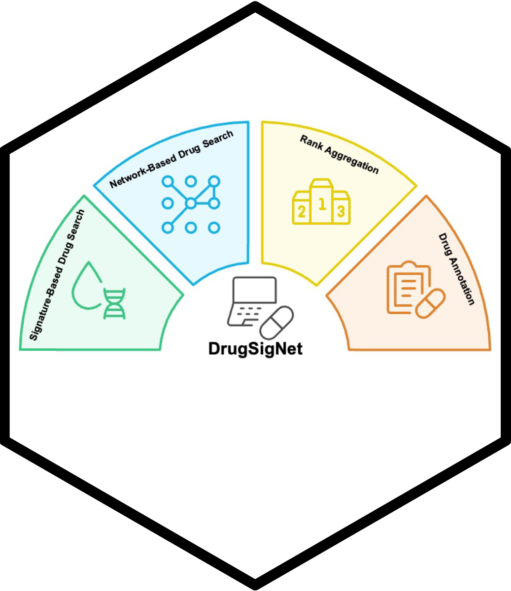

# DrugSigNet

[](https://cran.r-project.org/web/licenses/MIT%20%2B%20file%20LICENSE)
[](https://github.com/compneurobio/DrugSigNet)
[](https://github.com/compneurobio/DrugSigNet/actions)
[](https://hub.docker.com/u/orhan1117)



DrugSigNet is an R package for reproducible *in silico* drug repurposing using disease signatures, biological networks, and consensus ranking.

The package supports three common analysis scenarios: signature-based drug search from differential expression data, network-based prioritization from disease genes, and integrated workflows that combine both evidence types. DrugSigNet also provides tools for drug annotation, enrichment analysis, and visualization of prioritized candidates.

## Why DrugSigNet?

DrugSigNet helps users move from disease evidence to prioritized and interpretable drug candidates in a modular workflow. It provides:

- **Signature-based drug search** using CMAP, LINCS, gCMAP, and correlation-based scoring.
- **Network-based prioritization** using TrustRank, harmonic centrality, degree centrality, network proximity, and diffusion-based scoring.
- **Consensus ranking** using CRank, Dowdall, and Robust Rank Aggregation.
- **Drug annotation** for mechanisms of action, indications, ATC classes, drug status, blood-brain-barrier information, clinical trials, and adverse events.
- **Visualization helpers** for ranked candidates, method agreement, overlaps, enrichment, and annotation summaries.
- **Export and reporting** with multi-sheet Excel output and HTML/PDF analysis reports.

## Choosing a workflow

| If you have... | Start with... | Main output |
|---|---|---|
| A signed differential expression signature with `Entrez` and `FC` columns | `drugSignaturePipeline()` | Signature-based drug rankings and consensus results |
| Disease-associated genes but no signed expression signature | `drugNetworkPipeline()` | Network-based drug rankings from disease genes and interaction networks |
| Both expression and disease-gene evidence | `drugRepurposingPipeline(mode = "both")` | Integrated signature-network rankings |
| A candidate drug list from any source | `annotate_drugs()` | Drug metadata, mechanisms, indications, status, safety, and trial context |
| Completed rankings or annotations | Visualization helpers or `run_visualization = TRUE` | Plots for method agreement, overlap, enrichment, annotation, and similarity |
| A completed pipeline result | `write_pipeline_results()` or `write_report()` | Excel workbooks or HTML/PDF analysis reports |

For a first test run, set `run_drug_annotation = FALSE` and `run_visualization = FALSE`. Re-enable annotation and visualization after confirming that the core ranking workflow runs successfully.

## Installation

DrugSigNet requires **R 4.4.0 or newer**. Choose an installation method based on your environment. Use Bioconductor 3.20 with R 4.4, or Bioconductor 3.22 with R 4.5. The R Pixi installer matches the calling R major/minor series; standalone shell/container installations default to R 4.5. The maintained dependency manifest is [`tools/runtime-dependencies.tsv`](tools/runtime-dependencies.tsv).

| Environment | Recommended method | Notes |
|---|---|---|
| Linux or Linux-based RStudio without sudo | [Project-local Pixi](#project-local-pixi-recommended-for-rootless-setup) | Isolated R, Python, and native dependencies |
| R with preinstalled system libraries | [Standard R installation](#standard-r-installation) | Install Python dependencies separately for network methods |
| Docker Desktop or a reproducible container | [Docker](#docker) | Use the maintained image, not bare Rocker |

### Project-local Pixi (recommended for rootless setup)

The Pixi installer creates a reproducible project with its own R, Python, native libraries, and lock file, without requiring sudo. Run in R (including RStudio):

```r
branch <- "codex/pixi-host-r44-install"
source(paste0(
  "https://raw.githubusercontent.com/orhanbellur/DrugSigNet/",
  branch, "/install-pixi.R"
))
install_drugsignet_pixi(
  package_ref = paste0("orhanbellur/DrugSigNet@", branch),
  project_dir = "~/DrugSigNet-test"
)
```

The installer provisions the environment, installs DrugSigNet, and validates it. It reuses `pixi.lock` and the existing environment on subsequent runs. HTML vignettes are omitted by default for faster installation; use `build_vignettes = TRUE` if needed.

Native macOS Pixi installs require Xcode Command Line Tools (`xcode-select --install`). The installer detects the macOS SDK and preserves its header path in Pixi activation for source package compilation.

The installer selects the calling R **major/minor series** automatically: R
4.4.0 selects Pixi R 4.4.x; R 4.5 selects Pixi R 4.5.x. Pixi can select a newer
patch release within that series. It does not replace the R executable running
inside RStudio. The installer validates the runtime, activates the matching
package library in the current session, and verifies that DrugSigNet loads.
After the installation call above, run directly in the **same R console**:

```r
library(DrugSigNet)
```

No second RStudio session or Terminal command is needed for normal use. User
and project startup profiles preserve the library selection for the matching R
series. The installer recreates its managed runtime when changing R series so
packages compiled for the previous R are not retained. Keep user data outside
`.pixi/envs/default`, which is an installer-managed directory.

On Apple Silicon Macs, `signatureSearch`/`signatureSearchData` are installed from
Bioconductor inside the selected Pixi R because Bioconda does not provide them
for `osx-arm64`. R 4.4 uses Bioconductor 3.20 and the 2025-04-30 CRAN snapshot;
R 4.5 uses Bioconductor 3.22. The installer configures project OpenJDK, installs
`rcdk`/`fingerprint` from CRAN, and validates a CDK fingerprint calculation.
R 4.4 obtains `BoutrosLab.plotting.general` from CRAN because its available
Conda build requires R 4.5. Its plotting extensions are rebuilt against the same dated CRAN snapshot to
avoid incompatible serialized ggplot2 defaults. For R 4.4 source builds on Apple Silicon, BH >= 1.90 supplies the upstream
Boost header fix required by Clang 21; a project-local Makevars file provides
C++14 for older packages requesting C++11. These source installations are
outside `pixi.lock`; keep the printed package versions for reproducibility.

A compatible R series and dependencies must be available in the configured
Conda channels. An unavailable combination produces an installation error;
the installer does not substitute a different R series. Package support for
R >= 4.4.0 and availability of external Pixi packages are separate requirements.

For hosts whose native libraries require a separate source build, the optional
`install_host = TRUE` mode installs a second copy into
`~/R/DrugSigNet/<major.minor>/library` (override with `host_library`). This mode
requires the host's native development dependencies and Pandoc for vignette
builds. The default version-matched route does not require this flag.

### Standard R installation

Use this route only when the required system libraries are already installed, or when your Linux session has root/passwordless sudo for package-manager operations.

```r
stopifnot(getRversion() >= "4.4.0")
if (!requireNamespace("pak", quietly = TRUE)) {
  install.packages("pak")
}
options(timeout = max(1200, getOption("timeout", 60)))
options(pkg.sysreqs = FALSE, pkg.build_vignettes = TRUE)
Sys.setenv(PKG_SYSREQS = "false", PKG_BUILD_VIGNETTES = "true")
pak::pkg_install(
  "orhanbellur/DrugSigNet@codex/support-r-44",
  dependencies = NA,
  upgrade = FALSE,
  ask = FALSE
)
```

Set `pkg.sysreqs = TRUE` and `PKG_SYSREQS=true` **only** when OS package installation is authorized; otherwise `pak` can fail while attempting `sudo apt-get`. Missing headers and native libraries must be provided by the image builder or administrator. `dependencies = NA` avoids installing the entire optional development dependency set.

For Python-backed network methods, run:

```r
DrugSigNet::setup_python_dependencies()
DrugSigNet::check_drugsignet_installation(stop_on_error = TRUE)
```

Optional annotation plots use `ggalluvial`, `ggforce`, and `wordcloud`. For a plain R installation, install the packages needed for those plots with `install.packages(c("ggalluvial", "ggforce", "wordcloud"))`. Complete Pixi/container installers include them. Installed HTML vignettes use local asset directories; keep the complete `doc` directory together when copying or sharing them.

The signature workflow additionally uses the optional Bioconductor package `signatureSearch`; install it if your chosen signature methods require it:

```r
BiocManager::install("signatureSearch")
```

Do not use a plain `rocker/rstudio` image as a substitute for the maintained DrugSigNet image: the base image alone does not contain all required OS and Python dependencies.

### Platform and troubleshooting notes

- **Windows:** Native Windows supports signature-based methods, but network methods requiring Python `graph-tool` need WSL or Docker. Docker Desktop on macOS/Windows runs the Linux-based runtime.
- **HPC/containers:** No unprivileged R command can install missing Debian packages. Use a preconfigured image or the Pixi environment above; see [`DOCKER.md`](DOCKER.md).
- **Parallel execution:** DrugSigNet uses PSOCK workers across platforms. Signature-method batches are checkpointed for recovery; large LINCS2 workloads still require sufficient memory. Respect HPC CPU and memory allocations.
- **Vignettes:** Build source vignettes during installation when you need `browseVignettes("DrugSigNet")`. See [Documentation](#documentation) for an RStudio Server fallback.
- **Validation:** Run `DrugSigNet::check_drugsignet_installation(stop_on_error = TRUE)` to identify missing dependencies; `DrugSigNet::setup_synapser()` checks Synapse client support.

## Quick start

### Signature-based workflow

Run a small signature-based workflow from a two-column disease signature.

```r
library(DrugSigNet)

signature_input <- data.frame(
  Entrez = c("7157", "5290", "1956", "7422", "4609", "207"),
  FC = c(2.1, -1.4, 1.8, -2.2, 1.3, -1.7)
)

signature_result <- drugSignaturePipeline(
  signature_input = signature_input,
  top_k = 50,
  n_workers = 1,
  run_drug_annotation = FALSE,
  run_visualization = FALSE
)
```

### Network-based workflow

Run a network-based workflow from disease genes.

```r
disease_genes <- c("TP53", "PIK3CA", "EGFR", "VEGFA", "AKT1")

network_result <- drugNetworkPipeline(
  disease_genes = disease_genes,
  run_all_network_methods = FALSE,
  top_k = 50,
  run_drug_annotation = FALSE,
  run_visualization = FALSE
)
```

### Integrated workflow

Combine signature and disease-gene evidence in one workflow.

```r
repurposing_result <- drugRepurposingPipeline(
  signature_input = signature_input,
  disease_genes = disease_genes,
  mode = "both",
  run_all_network_methods = FALSE,
  top_k = 50,
  run_drug_annotation = FALSE,
  run_visualization = FALSE
)
```

## Input requirements

| Workflow component | Required input | Notes |
|---|---|---|
| Signature workflow | Data frame with `Entrez` and `FC` columns | Include both positive and negative fold-change values |
| Network workflow | Non-empty disease gene vector or data frame | Custom networks can be supplied with `ppi_network` and `drug_target_network` |
| Custom PPI network | Data frame with `gene1` and `gene2` columns | Use identifiers consistent with disease genes and drug targets |
| Custom drug-target network | Data frame with `ID`, `Drug`, `Target`, and `Group` columns | Targets should use the same identifier system as the PPI network |
| Annotation workflow | Character vector or data frame of drug names | Synapse-backed annotation data may require `SYNAPSE_AUTH_TOKEN` |
| Visualization workflow | Ranking, annotation, enrichment, or similarity tables | Required columns depend on the selected plotting function |

## Main functions

| Function | Purpose |
|---|---|
| `drugSignaturePipeline()` | Run signature-based drug repurposing from differential expression signatures |
| `drugNetworkPipeline()` | Run network-based prioritization from disease genes and interaction networks |
| `drugRepurposingPipeline()` | Run signature, network, or integrated workflows |
| `annotate_drugs()` | Add drug metadata, mechanisms, indications, safety, and trial information |
| `CRank()`, `Dowdall()`, `RRA()` | Aggregate method-specific rankings into consensus rankings |
| Visualization helpers | Generate plots for ranked drugs, method agreement, overlaps, enrichment, and annotation summaries |
| `write_pipeline_results()` | Export available pipeline tables to a multi-sheet Excel workbook |
| `write_report()` | Generate HTML/PDF reports from one or more pipeline results |

## Export and reporting

Completed pipeline results can be exported to Excel or summarized as an
HTML/PDF report:

```r
write_pipeline_results(
  result_obj = repurposing_result,
  file_path = "DrugSigNet_results.xlsx",
  top_n = 100
)

write_report(
  object = repurposing_result,
  file = "DrugSigNet_report",
  device = "html",
  interactive = TRUE
)
```

Set `write_results = TRUE` in `write_report()` to create the Excel export
alongside the report. See the complete case-study vignette for additional
examples and reporting options.

## Documentation

After installation, open the package vignettes with:

```r
browseVignettes("DrugSigNet")
```

If RStudio Server shows the vignette index but its `/library/DrugSigNet/doc/`
links return HTTP 404, the files may still be installed correctly while the
server refuses that system-library route. Open a session-local copy instead:

```r
browse_drugsignet_vignette()                  # vignette index
browse_drugsignet_vignette("getting-started") # one vignette
```

This copies the installed documentation and its assets to the R session's
temporary directory before passing it to the configured RStudio viewer.
The maintained Linux installer also makes the root-installed package directory
world-readable and traversable for the unprivileged RStudio Server session.

Recommended reading order:

1. [Getting started](vignettes/getting-started.Rmd)
2. [Choosing an analysis strategy](vignettes/choosing-analysis-strategy.Rmd)
3. [Signature methods](vignettes/signature-methods.Rmd)
4. [Network methods](vignettes/network-methods.Rmd)
5. [Rank aggregation](vignettes/rank-aggregation.Rmd)
6. [Drug annotation](vignettes/drug-annotation.Rmd)
7. [Visualization](vignettes/visualization.Rmd)
8. [Signature workflow](vignettes/signature-workflow.Rmd)
9. [Network workflow](vignettes/network-workflow.Rmd)
10. [Complete case study](vignettes/complete-case-study.Rmd)

For function-level documentation, load the package and use:

```r
?drugSignaturePipeline
?drugNetworkPipeline
?drugRepurposingPipeline
?write_pipeline_results
?write_report
```

## Docker

Docker is recommended when users want a reproducible DrugSigNet environment without manually installing R, system libraries, Python modules, or optional network dependencies.

### Use a pre-built Docker image

Pre-built DrugSigNet Docker images for Linux, macOS, and Windows are available from the [`orhan1117` Docker Hub account](https://hub.docker.com/u/orhan1117). Pull the image corresponding to your platform:

**Linux**

```bash
docker pull orhan1117/drugsignet:linux
```

**macOS**

```bash
docker pull orhan1117/drugsignet:macos
```

**Windows**

```powershell
docker pull orhan1117/drugsignet:windows
```

The `docker pull` command downloads the selected image to the local Docker installation. If the image is already present, Docker checks for and retrieves a newer version when available.

### Run RStudio Server

After pulling the image, start the container for your platform.

**Linux**

```bash
docker run --rm -p 8787:8787 -e PASSWORD=drugsignet orhan1117/drugsignet:linux
```

**macOS**

```bash
docker run --rm -p 8787:8787 -e PASSWORD=drugsignet orhan1117/drugsignet:macos
```

**Windows (PowerShell)**

```powershell
docker run --rm -p 8787:8787 -e PASSWORD=drugsignet orhan1117/drugsignet:windows
```

Open <http://localhost:8787> in a web browser and sign in with username `rstudio` and password `drugsignet`.

To run R directly instead of RStudio Server, use:

```bash
docker run --rm -it orhan1117/drugsignet:linux R
```

Replace `linux` with `mac` or `windows` when using the corresponding image.

### Build the image locally

Users who prefer to build DrugSigNet from source can build the Linux image from the repository root:

```bash
docker buildx build --load -f docker/linux/Dockerfile -t drugsignet:linux .
```

The maintained image uses R 4.5.x with its matching Bioconductor release and
checks the complete installation while building. Pulling
`rocker/rstudio:4.5.2` only downloads the base image: it does not execute the
`apt-get`, Java configuration, R-package, or Python-package installation steps
in a Dockerfile that starts `FROM rocker/rstudio:4.5.2`. Therefore, the same R
version can work in a derived image and fail in the bare Rocker image. Use the
maintained build above, or build—not merely pull—your complete custom
Dockerfile.

For a custom Debian, Ubuntu, or Rocker image, a single root command installs
the native prerequisites, R/Bioconductor dependencies, DrugSigNet, its Python
runtime, and validates the result:

```dockerfile
COPY . /opt/DrugSigNet
RUN /opt/DrugSigNet/tools/install_drugsignet_linux.sh
```

This must be an outer installation entry point rather than a package
`configure` hook because R installs dependencies before running DrugSigNet's
hook. The package's `SystemRequirements` field also records the native
requirements; see [`DOCKER.md`](DOCKER.md) for the complete Rocker example.

For platform-specific builds, configuration, and troubleshooting, see [`DOCKER.md`](DOCKER.md).
The repository includes `docker/macos/build.sh` for Apple Silicon and Intel
macOS hosts, plus `docker/windows/build.ps1` for Docker Desktop on Windows.

## Synapse authentication

Some DrugSigNet annotation resources are hosted on Synapse and require a
Synapse Personal Access Token (PAT).

For instructions on creating a token and configuring it securely in R, see the
[Getting Started vignette](vignettes/getting-started.Rmd).

Synapse authentication is optional and is not required for the basic
signature- or network-based workflows.

## Citation

If DrugSigNet contributes to your analysis or publication, please cite the package. Citation metadata is available in [`CITATION.cff`](CITATION.cff).

## Issues and feature requests

Please report bugs, questions, and feature requests through [GitHub issues](https://github.com/compneurobio/DrugSigNet/issues).
